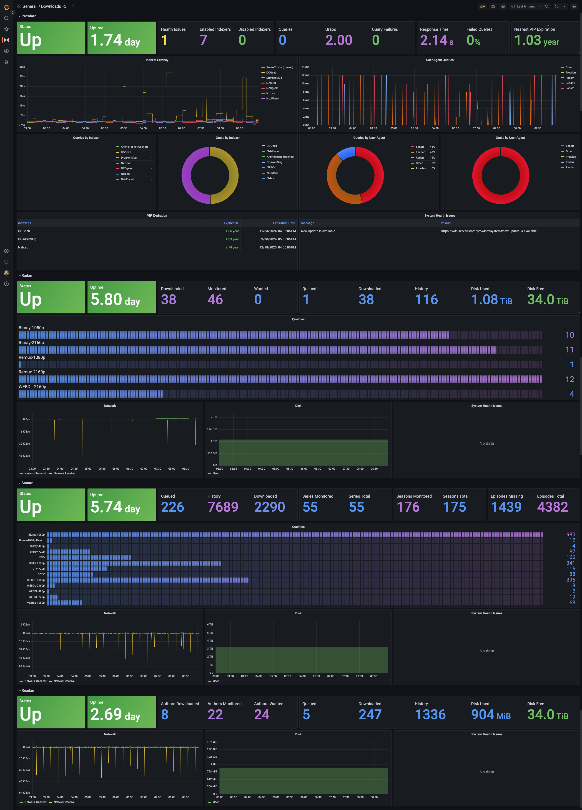

<div align="center">

# k8s-mediamanager

_An all-in-one Opiniated Kubernetes media manager helm chart built with security in mind._

</div>

<div align="center">


</div>

Allows you to create a fully working and complete media manager on #kubernetes, respecting the latest [security best practices](https://github.com/kubernetes-sigs/kubebuilder/discussions/2840): 
- Rootless containers
- Enforce strict *pod-level* `podSecurityContext` for all pods at the runtime level: 
    ```
    securityContext:
        runAsNonRoot: true
        runAsUser: {{ .Values.general.puid }}
        runAsGroup: {{ .Values.general.pgid }}
        fsGroup: {{ .Values.general.pgid }}
        seccompProfile:
          type: RuntimeDefault
    ```

- Enforce strict *container-level* `securityContext` with all capabilites dropped and no priviledge escalation:
    ```
    securityContext:
        allowPrivilegeEscalation: false
        capabilities:
            drop:
            - ALL
    ```
- All public endpoints require authentication, support SSL termination at ingress through CNI anotations (TLS-ACME). -- *No* insecure `nodePort` endpoints.
- All pods runnning dedicated serviceAccount (no access to the k8s API from pods)
- Metrics endpoints and monitoring enabled by default for all apps

The goal of this project is to support [semantically versioned](https://semver.org/), [rootless](https://rootlesscontaine.rs/), and [multiple architecture](https://www.docker.com/blog/multi-arch-build-and-images-the-simple-way/) containers for various applications. Container images used by the chart are from [oneDrop](https://github.com/onedr0p/containers). If you have questions regarding the images, ask there.

Currently based on:

- [Plex Media Server](https://www.plex.tv/ "Plex Media Server") - A complete and fully funtional mediaserver that allows
you to render in a webUI your movies, TV Series, podcasts, video streams.

- [Tautulli](https://github.com/Tautulli/Tautulli "Tautulli") - A Python based monitoring and tracking tool for Plex Media Server. Mounted as sidecar container to plex.

- [Sonarr](https://sonarr.tv/ "Sonarr") - A TV series and show tracker, that allows the integration with download managers
for searching and retrieving TV Series, organizing them, schedule notifications when an episode comes up and much more.

- [Radarr](https://radarr.video/ "Radarr") - The same a **Sonarr**, but for movies!

- [Lidarr](https://github.com/Lidarr/Lidarr "Lidarr") - Looks and smells like Sonarr but made for music.

- [Exportarr](https://github.com/onedr0p/exportarr "Exportarr") - AIO Prometheus Exporter for Sabnzbd, Bazarr, Prowlarr, Lidarr, Readarr, Radarr, and Sonarr. Mounted as sidecar container to the aformentionned.

- [Prowlarr](https://github.com/Prowlarr/Prowlarr "Prowlarr") - An indexer manager/proxy built on the popular \*arr .net/reactjs base stack to integrate with your various PVR apps. Prowlarr supports management of both Torrent Trackers and Usenet Indexers.

- [Filesolverr](https://github.com/FlareSolverr/FlareSolverr "Filesolverr") -  Proxy server for prowlarr to bypass Cloudflare protection. Mounted as sidecar container to Prowlarr

- [Transmission](https://transmissionbt.com/ "Transmission") - A fast, easy and reliable torrent client.

- [Cleanuparr](https://github.com/Cleanuparr/Cleanuparr "Cleanuparr") - Removes failed, stalled and malicious downloads from the \*arr queues and the torrent client. Disabled by default.

Each of the components can be **enabled** or **disabled** if you already have something in place in your environment.

**Pull requests to add support for more are welcome**

## Requirements
- Kubernetes 1.25+, tested on 1.30.5
- A CSI supporting `ReadWriteMany` accessmode for the media library. Tested with [nfs-ganesha-server-and-external-provisioner](https://github.com/kubernetes-sigs/nfs-ganesha-server-and-external-provisioner?tab=readme-ov-file)
- A CNI supporting LoadBalancer services. We strongly recommend Cilium, Although not recommended, You can also edit your `values.yaml` to use `nodePorts` otherwise.
- OPTIONAL: A TLS-ACME cluster-issuer. Although optional, we strongly recommend you setup `letsencrypt` on your cluster for production deployments (public endpoints).
- OPTIONAL: A `kube-prometheus-stack` instance in order to enable monitoring/alerting


## Deployment

[Helm](https://helm.sh) must be installed to use the charts.  Please refer to
Helm's [documentation](https://helm.sh/docs) to get started.

Once Helm has been set up correctly, add the repo as follows:
  
    helm repo add k8s-mediamanager https://bernardgut.github.io/k8s-mediamanager

If you had already added this repo earlier, run `helm repo update` to retrieve
the latest versions of the packages.  You can then run `helm search repo
k8s-mediamanager` to see the charts.

To install the k8s-mediamanager chart:

    helm upgrade --install -n <namespace> -f values.yaml kmm k8s-mediamanager/k8s-mediamanager --create-namespace

To uninstall the chart:

    helm delete -n <namespace> kmm

To upgrade all components of the chart simply run `helm repo update` and run the installation command again.

A sample minimum `values.yaml` for a prod deployment with SSL, and proper config segmentation is provided below :

```
general:
  ingress_host: services.endpoint.io
  plex_ingress_host: plex.endpoint.io
  sharedStorage:
    size: 5Gi
    storageClassName: "nfs"
    persistentVolumeClaim:
      claimName: "my-media-library" 

plex:
  ingress:
    annotations:
      ingress.cilium.io/loadbalancer-mode: shared
      kubernetes.io/tls-acme: "true"
    tls: 
      enabled: true

  volume:
    storageClassName: "sa" # Used for config, put whatever ReadWriteOnce SC you have here

prowlarr:
  apiKey: "CHANGEME-generate-a-random-32char-hex-key" # Change this prior to deploying
  ingress:
    annotations:
      ingress.cilium.io/loadbalancer-mode: shared
      kubernetes.io/tls-acme: "true"
    tls:
      enabled: true
  volume:
    storageClassName: "sa" # Used for config, put whatever ReadWriteOnce SC you have here

radarr:
  apiKey: "CHANGEME-generate-a-random-32char-hex-key" # Change this prior to deploying
  ingress:
    annotations:
      ingress.cilium.io/loadbalancer-mode: shared
      kubernetes.io/tls-acme: "true"
    tls:
      enabled: true
  volume:
    storageClassName: "sa" # Used for config put whatever ReadWriteOnce SC you have here

sonarr:
  apiKey: "CHANGEME-generate-a-random-32char-hex-key" # Change this prior to deploying
  ingress:
    annotations:
      ingress.cilium.io/loadbalancer-mode: shared
      kubernetes.io/tls-acme: "true"
    tls:
      enabled: true
  volume:
    storageClassName: "sa" # Used for config put whatever ReadWriteOnce SC you have here

lidarr:
  apiKey: "CHANGEME-generate-a-random-32char-hex-key" # Change this prior to deploying
  ingress:
    annotations:
      ingress.cilium.io/loadbalancer-mode: shared
      kubernetes.io/tls-acme: "true"
    tls:
      enabled: true
  volume:
    storageClassName: "sa" # Used for config put whatever ReadWriteOnce SC you have here

transmission:
  ingress:
    annotations:
      ingress.cilium.io/loadbalancer-mode: shared
      kubernetes.io/tls-acme: "true"
    tls:
      enabled: true
  config:
    auth:
      enabled: true
      username: "admin"
      password: "admin12345"
  volume:
    storageClassName: "sa" # Used for config put whatever ReadWriteOnce SA you have here
```

See the chart [values.yaml](charts/k8s-mediamanager/values.yaml) for more details on available parameters.

If you already have pre-existing volumes you can patch them using the `helm-adopt.sh` script to avoid having the 
`error : resources already exist` issue when running the install script

## Usage

Upon deploying the chart with the command above the following endpoints will become available externally:

```
<general.ingress_host>:443/<service> # Services UIs: where service=[lidarr,radarr,sonarr,prowlarr,tautulli,transmission]
<general.plex_ingress_host>:443/     # Plex UI
<TRANSMISSION_LOADBALANCER_IP>:<transmission.container.port.peer> # transmission peer protocol endpoint
```

Where `general.ingress_host`, `general.plex_ingress_host`, `transmission.container.port.peer` are defined in your `values.yaml, 
and `TRANSMISSION_LOADBALANCER_IP` is the public IP assined by your loadbalancer to the transmission loadbalancer service. 
Assuming you left the default values above, You can get it by running `kubectl get svc -n <namespace> kmm- transmission-peer` and watch for the `EXTERNAL_IP` field.

## Changing the configuration of services
**-arr services are configured to setup authentication upon first start. It is strongly recommended to connect to your -arr services
and setup authentication.**

All services start with a default configuration set from the chart. Transmission allows to update the configuration from the chart directly (stateless), while
-arr aps are stateful and require you to drop into a shell and edit the config manually. You can do so by running 
```
kubecetl exec -it deployment/<*-arr> k8s-mediamanager -- sh
```

you can then edit the config files in `/config` of each container. In the future, we might update the chart to make configuration management of -arr apps easier

## Plex: secure connections

TLS terminates at the Gateway (HTTPRoute); the gateway→pod hop and the kubelet
probes are plain HTTP. Setting **Settings → Network → Secure connections =
Required** in the Plex web UI therefore breaks both gateway access and the
probes (Plex refuses non-TLS from non-loopback sources; `secureConnections="0"`
persists in `Preferences.xml` on the config PVC).

Since chart 2.3.0 this cannot brick the pod anymore:

- `plex.preferences` values are re-applied on **every boot** via the
  `home-operations/plex` entrypoint (`PLEX_PREFERENCE_<n>` → `setPref`), pinning
  `secureConnections: "1"` (Preferred). A UI flip to Required only lasts until
  the next restart.
- startup/liveness probes are TCP (process-alive only): an app-level misconfig
  degrades the pod to NotReady, it is never kill-looped. Readiness stays HTTP
  `/identity` — the same hop the gateway uses (`plex.probes.readinessScheme`
  can be set to `HTTPS` for setups that genuinely run Required end-to-end).

Preferred is not a client-facing downgrade: Plex apps and app.plex.tv keep
end-to-end TLS via `*.plex.direct`, and browser users get TLS at the gateway.

## Plex: read-only media

`plex.mediaReadOnly: true` mounts `/tv`, `/movies` and `/music` read-only.
Deleting media from the Plex UI then fails; set
`plex.preferences.allowMediaDeletion: "0"` to remove the option. Optimized
versions stored in the library folders cannot be created either.

## qBittorrent: managed configuration

`qBittorrent.conf` and `categories.json` are rendered by the chart and rewritten
on every pod start; only the WebUI password hash survives, so WebUI changes do
not persist.

| Value | Default | qBittorrent setting |
|---|---|---|
| `qbittorrent.config.peerDiscovery.dht` / `.pex` / `.lsd` | `true` | `Session\DHTEnabled` / `PeXEnabled` / `LSDEnabled` |
| `qbittorrent.config.shareLimits.ratio` | `2` | `Session\GlobalMaxRatio` |
| `qbittorrent.config.shareLimits.seedingMinutes` | `4320` | `Session\GlobalMaxSeedingMinutes` |
| `qbittorrent.config.shareLimits.inactiveSeedingMinutes` | `1440` | `Session\GlobalMaxInactiveSeedingMinutes` |

The first share limit reached stops the torrent (`ShareLimitAction=Stop`); \*arr
apps with *Remove Completed* on then remove it once imported, except torrents
moved to a post-import category, which the apps never remove. `-1` disables a
limit. Queued torrents accrue no seeding time, so only the inactive limit stops
them.

Categories follow the enabled apps: `radarr` and `radarr-imported`, `tv-sonarr`
and `tv-sonarr-imported`, `lidarr`. Use the same names for the download-client
categories in each app.

## \*arr apps: shutdown and startup

`<app>.terminationGracePeriodSeconds` (sonarr, radarr, lidarr, prowlarr; default
`120`) exceeds the .NET host shutdown timeout, so the apps exit on their own
instead of being killed. A startup probe gives database migrations 5 minutes
before the liveness probe applies.

The apps do not wait for an import in progress when they stop. Unless
`dataMountPath` puts the downloads and the library on one mount, an import is
a copy, and a stop mid-copy leaves a truncated file: roll these pods only
while the import queue is idle.

## \*arr apps: hardlinked imports (single `/data` mount)

`<app>.mediaSubPaths` mounts each sub-path of the shared volume on its own
(`/downloads`, `/tv`, ...). The kernel refuses hardlinks and renames across
mounts, so with these mounts alone no import is a hardlink, even with *Use
Hardlinks instead of Copy* on: it is a full copy, stored twice while the
torrent seeds, or at best a reflink clone where the app's runtime and the
filesystem support one.

`<app>.dataMountPath` (sonarr, radarr, lidarr; empty by default) also mounts
the whole volume at the given path, e.g. `/data`. Root folders and download
paths under it share one mount, so an import is a hardlink while the torrent
seeds and a rename otherwise. To move an existing install with the default
sub-paths, keeping the old mounts until the last step:

1. Set `dataMountPath: /data`. Only the \*arr pods restart.
2. In each app, add the root folder `/data/media/<tv|movies|music>` and move
   every series, movie or artist to it without moving files. Point import
   lists and Radarr collections at it too.
   **Warning:** while both mounts exist, the old and new folder are the same
   directory. If the app is told to move files, it treats the source as an
   existing target, deletes it, and the files are lost.
3. Add a remote path mapping in each app: host = the download client's host,
   remote path `/downloads/`, local path `/data/downloads/`.
4. Point the recycle bin at a folder under the data mount, outside the root
   folders (e.g. `/data/recycle/tv/`). The folder must already exist.
5. If the app notifies Plex, map `/data/media/<tv|movies|music>` to Plex's
   `/<tv|movies|music>` in the connection's path mapping.
6. Remove the old root folders, then set `mediaSubPaths: []`.

The download client and Plex keep their own mounts.

## Cleanuparr

`cleanuparr.enabled: true` deploys Cleanuparr (queue cleaner, malware blocker)
at `<gateway.restricted.hostname>/cleanuparr`.

| Value | Default | Notes |
|---|---|---|
| `cleanuparr.image.tag` | `2.10.8` | a minor bump is a breaking release (may block rollback): back up `/config` first |
| `cleanuparr.service.port` | `11011` | also the app's `PORT` |
| `cleanuparr.ingress.path` | `/cleanuparr` | also the app's `BASE_PATH`; all probes use `<path>/health` (`/health/ready` fails on an unhealthy download client and would take the UI route down) |
| `cleanuparr.persistence.*` | `1Gi`, `ReadWriteOnce` | `/config`: SQLite databases, logs, keys |
| `cleanuparr.resources` | `20m`/`192Mi`, limits `500m`/`512Mi` | |
| `cleanuparr.networkPolicy.egressFQDNs` | `[]` | Cilium `toFQDNs` selectors allowed on port 443 |
| `cleanuparr.extraEnv`, `cleanuparr.nodeSelector` | empty | |

The pod runs as `global.puid` with a read-only root filesystem: the image's
entrypoint skips its chown/gosu step for non-root users, and the app writes only
to `/config` and `/tmp`. Its network policy allows no internet egress beyond
`egressFQDNs`, so the in-app version check and remote blocklists fail unless
their hosts are listed there (or the check is turned off with
`cleanuparr.config.general.statusCheckEnabled: false`).

Cleanuparr keeps its settings in SQLite databases on its config PVC. Set
`cleanuparr.config.enabled: true` to manage them from values, as described in
[Cleanuparr settings as code](#cleanuparr-settings-as-code). Otherwise the UI
owns them: keep them in a private runbook, because site-specific values do not
belong in this repository.

### Cleanuparr settings as code

With `cleanuparr.config.enabled: true`, two init containers run on every pod
start, before the app does:

1. `cleanuparr-migrate` first checks the image tag, the migrations compiled into
   the image, and the databases on the volume. It then runs the app once with an
   invalid `BASE_PATH`: the app applies the image's database migrations and stops
   before serving anything. That run logs one expected `Invalid BASE_PATH
   configuration` error. It appears in the init container log and in
   `/config/logs`, not in the in-app log viewer, and a stored log level of
   `fatal` hides it.
2. `cleanuparr-config` runs `files/cleanuparr/apply_config.py` (Python standard
   library, already in the image). It validates `cleanuparr.config` and checks
   that the database schema is exactly the one the script was written for. It
   then writes every difference and logs each change. Secrets never appear in
   the log, including credentials embedded in URLs.

Values are the only source of truth, as with the
[qBittorrent managed configuration](#qbittorrent-managed-configuration):

- A UI edit takes effect at once, but the next pod start reverts it. The
  `cleanuparr-config` log lists each reverted field. Only a new pod re-runs the
  init containers: an upgrade that changes the pod, an eviction, a node reboot,
  or `kubectl rollout restart deployment/<fullname>-cleanuparr`, which also
  enforces values on demand. A crash or liveness restart of the container
  inside the same pod does not.
- Download clients, \*arr instances, rules and notification providers that are
  missing from values get deleted. The cascades match a delete in the UI,
  including the event-history cleanup for a deleted \*arr instance.
- Items are matched by name, case-insensitively. Renaming an item in values
  therefore deletes it and creates a new one, which drops its Seeker,
  custom-format and blacklist-sync history. A UI rename keeps that history; to
  keep it, rename in the UI first and update values before the next pod start.
- Turning `general.dryRun` off purges the dry-run strikes and events, exactly
  like the UI toggle.

These are not managed:

- the account, apart from the bootstrap and `auth.apiKey` below; this covers
  its password, 2FA, OIDC and Plex link;
- runtime state: strikes, events, Seeker progress;
- the blacklist-sync schedule, which the app does not expose.

The desired state includes the \*arr API keys and download-client credentials,
so it is rendered into the Secret `<fullname>-cleanuparr-config`, for example
`kmm-k8s-mediamanager-cleanuparr-config` for release `kmm`. The scripts go into
the ConfigMap `<fullname>-cleanuparr-config-scripts`. Both are hashed into the
pod template, so a change to either restarts the pod. With `config.enabled:
false` (the default), nothing extra is rendered.

**Enabling on an existing install.** The first start prunes everything that
values do not list, so:

1. Back up `/config`.
2. Set `mode: plan`.
3. Copy settings into values until the `cleanuparr-config` log shows only the
   changes you want.
4. Switch to `mode: apply`.

| Value | Default | Notes |
|---|---|---|
| `cleanuparr.config.enabled` | `false` | |
| `cleanuparr.config.mode` | `apply` | `plan` logs the changes without writing them |
| `cleanuparr.config.externalBaseUrl` | `""` | base of the links Cleanuparr shows; empty uses `https://<gateway.restricted.hostname>` when that gateway is enabled, for components with `ingress.enabled`, and no links otherwise |
| `cleanuparr.config.resources` | `10m`/`32Mi`, limits `200m`/`128Mi` | settings container; the migrate container uses `cleanuparr.resources` |
| `cleanuparr.config.auth.*` | empty | see *Account* below |
| `cleanuparr.config.general.*` | dry run on, version check off | General page, incl. `http.*`, `log.*`, `auth.*` (trusted networks) |
| `cleanuparr.config.queueCleaner.*` | off | incl. `failedImport.*`, `stallRules`, `slowRules` |
| `cleanuparr.config.malwareBlocker.*` | off | one `{enabled, blocklistType, blocklistPath}` per \*arr type |
| `cleanuparr.config.downloadCleaner.*` | off | schedule; the rules belong to each download client |
| `cleanuparr.config.blacklistSync.*` | off | |
| `cleanuparr.config.seeker.*` | search on, proactive search off | `searchEnabled` is the switch for every search, including the replacement search after a removal: removals tell the \*arr apps not to search themselves. `proactiveSearchEnabled` adds missing-item and upgrade searches for the instances with `seeker.enabled` |
| `cleanuparr.config.arr.<type>` | no instances | `failedImportMaxStrikes` (`-1` follows the queue cleaner) and `instances` |
| `cleanuparr.config.downloadClients` | `[]` | |
| `cleanuparr.config.notifications` | `[]` | |

`values.yaml` lists every key with its default. Keys are the UI field names in
camelCase:

- An absent or `null` key takes the default.
- An unknown key, a value out of range, or a combination the app would reject
  stops the pod in `Init`. `cleanuparr-config` then writes nothing.
- Names must be unique within their list.
- Cron expressions use Quartz syntax (seconds first) and must fire every day,
  at least every 5 hours. The app's limit is 6 hours, measured in local time,
  so a 6-hour schedule fails on the night daylight saving time ends. For the
  queue and download cleaners, fires must also be at least 30 s apart.
- Sizes are written as `100MB` (KB, MB or GB).

Item fields (defaults in brackets):

| List | Fields |
|---|---|
| `arr.<type>.instances[]` | `name`; `enabled` [true]; `version` [sonarr 4, radarr 6, lidarr 3, readarr 0.4, whisparr 2 (or 3), sportarr 3, lazyLibrarian 1]; `url`; `apiKey`; `externalUrl` [""]; `fromChart` [false]: sonarr, radarr and lidarr only, derives `url`, `apiKey` and `externalUrl` from this chart; `seeker` (sonarr and radarr only): `enabled` [false], the scope of proactive search, `skipTags` [], `activeDownloadLimit` [3], `minCycleTimeDays` [7], `monitoredOnly` [true], `useCutoff`, `useCustomFormatScore`, `ignoreStruckDownloads` [false] |
| `downloadClients[]` | `name`; `enabled` [true]; `fromChart`: `qbittorrent` derives `typeName`, `host`, `urlBase`, the credentials from `qbittorrent.config.auth.*` (the chart does not set the WebUI password, so they must match the WebUI login) and, unless set, `externalUrl`; otherwise `typeName` (qbittorrent, deluge, transmission, utorrent, rtorrent), `host` (URL), `urlBase` [""], `username`, `password`; `externalUrl` [""]; `downloadDirectorySource` / `downloadDirectoryTarget` [""], both or neither; `seedingRules` []; `unlinked`, `deadTorrents`, `orphanedFiles` (absent = off) |
| `…seedingRules[]` | list order is the evaluation order. `name`; `categories` (at least one); `privacyType` [public] (public, private, both); `maxRatio` [-1]; `minSeedTime` [0] and `maxSeedTime` [-1], in hours; `maxRatio` or `maxSeedTime` must be 0 or more; `deleteSourceFiles` [true]; `trackerPatterns` []; `action` [delete] (delete, stop); `minSeeders` [0] (not rtorrent); `tagsAll`, `tagsAny` [] (qbittorrent, transmission); `maxInactiveDays` [-1] (qbittorrent) |
| `…unlinked` | `enabled` [false]; `targetCategory` [cleanuparr-unlinked]; `useTag` [false]; `categories` []; `ignoredRootDirs` [] |
| `…deadTorrents` | `enabled` [false]; `targetCategory` [cleanuparr-dead]; `useTag` [false]; `maxStrikes` [0], at least 3 when enabled; `categories` []; not rtorrent |
| `…orphanedFiles` | `enabled` [false]; `scanDirectories` []; `orphanedDirectory` [""]; `excludePatterns` []; `minFileAgeHours` [24]; `purgeAfterHours` [null] |
| `queueCleaner.stallRules[]` | `name`; `enabled` [true]; `maxStrikes` [3], 3 to 5000; `privacyType` [public]; `minCompletionPercentage` [0]; `maxCompletionPercentage` [100]; `resetStrikesOnProgress` [true]; `minimumProgress` [""], a size; `deletePrivateTorrentsFromClient`, `changeCategory` [false]. Enabled rules must not overlap in completion range for the same privacy type |
| `queueCleaner.slowRules[]` | the stall-rule fields without `minimumProgress`, plus `minSpeed` [""], a size per second; `maxTimeHours` [0]; `ignoreAboveSize` [""]; `ignoreWhileAltSpeedActive` [true]. Needs `minSpeed` or `maxTimeHours` |
| `notifications[]` | `name`; `type` (ntfy, notifiarr, apprise, pushover, telegram, discord, gotify); `enabled` [true]; `events`: `onFailedImportStrike`, `onStalledStrike`, `onSlowStrike`, `onQueueItemDeleted`, `onDownloadCleaned`, `onCategoryChanged`, `onSearchTriggered`, `onSearchItemGrabbed`, `onDownloadStopped`, `onForceImported` [false]; and exactly one provider block, named after the type |

Provider blocks:

- `ntfy`: `serverUrl`, `topics`, `authenticationType` [none] (none, basicauth, accesstoken), `username`, `password`, `accessToken`, `priority` [default], `tags`.
- `notifiarr`: `apiKey`, `channelId`.
- `apprise`: `mode` [api] (api, cli), `url`, `key`, `tags`, `serviceUrls`.
- `pushover`: `apiToken`, `userKey`, `devices`, `priority` [normal], `sound`, `retry`, `expire`, `tags`.
- `telegram`: `botToken`, `chatId`, `topicId`, `sendSilently`.
- `discord`: `webhookUrl`, `username`, `avatarUrl`.
- `gotify`: `serverUrl`, `applicationToken`, `priority` [5].

The network policies let the pod reach pods in its own namespace, including
this chart's \*arr apps and qBittorrent, and DNS. Any other target needs an
`egressFQDNs` entry and must serve HTTPS on port 443, for example a
notification server or an \*arr instance outside the chart.

Example:

```yaml
cleanuparr:
  enabled: true
  networkPolicy:
    egressFQDNs:
      - matchName: ntfy.example.com
  config:
    enabled: true
    queueCleaner:
      enabled: true
      cronExpression: "0 0/10 * ? * * *"
      failedImport:
        maxStrikes: 3
        patterns: ["No files found are eligible for import"]
      stallRules:
        - name: public-stalled
          maxStrikes: 18
          minimumProgress: 100MB
    arr:
      sonarr:
        instances:
          - name: sonarr
            fromChart: true
    downloadClients:
      - name: qBittorrent
        fromChart: qbittorrent
    notifications:
      - name: phone
        type: ntfy
        events: {onQueueItemDeleted: true}
        ntfy:
          serverUrl: https://ntfy.example.com
          topics: [media]
          authenticationType: accesstoken
          accessToken: "<token>"
```

**Account.**

- `auth.username` and `auth.passwordHash` create the admin account only when
  `users.db` has none, that is, on a new or wiped volume. Generate the hash with
  `htpasswd -nbBC 12 "" '<password>' | tr -d ':\n'`.
- After that, the account is never changed, except for its API key when
  `auth.apiKey` is set.
- Without these values, a new volume opens the setup wizard.
- `auth.apiKey` (64 lowercase hex characters: `openssl rand -hex 32`) is enforced
  on every start. Leave it empty to keep the app's own key.

**Check before an upgrade.** Use `mode: plan` to see the changes in the
`cleanuparr-config` log without writing them, or validate the rendered state
offline:

```sh
( umask 077
  helm template <release> charts/k8s-mediamanager -f <values> \
    --show-only templates/cleanuparr/config.secret.yaml \
    | yq '.data."desired-state.json"' | base64 -d > /tmp/ds.json
  python3 charts/k8s-mediamanager/files/cleanuparr/apply_config.py validate --desired /tmp/ds.json
  rm /tmp/ds.json )
```

**Troubleshooting.** If a step fails, the pod stays in `Init`. Read the logs
with `kubectl logs <pod> -c cleanuparr-migrate` or `-c cleanuparr-config`.

`cleanuparr-migrate` exits 3 when a check refuses or the migrate-only run
fails. Its checks:

- the image tag, or a digest that belongs to another release;
- databases already migrated by a newer Cleanuparr, for example after a
  rollback;
- `BASE_PATH` or `DATABASE_PROVIDER` set in `/config/cleanuparr.json`;
- a row in `__EFMigrationsLock`, left by a migration that crashed: back up
  `/config`, then delete that row.

If the run itself failed, earlier migrations may already be applied.

`cleanuparr-config` exit codes:

| Code | Meaning |
|---|---|
| 2 | invalid values; nothing was written |
| 3 | a guard refused (schema drift, more than one account, rows with broken references); nothing was written |
| 1 | unexpected error; every database the log does not list as `committed` was rolled back |
| 4 | the changes were committed, but the re-check still finds differences |

All write locks are taken before anything is written, so a failure before the
commits leaves every database unchanged. The commits then run in the order
`events.db`, `cleanuparr.db`, `users.db`. A stop between them leaves the
earlier ones committed, and the next start plans and writes the rest.

**Upgrading Cleanuparr.** Helm refuses an image tag other than
`SUPPORTED_APP_VERSION` in `apply_config.py`. Preflight also refuses an image
whose embedded migrations do not match. To move to a new version:

1. Diff these between the two tags:
   - `code/backend/Cleanuparr.Persistence.Sqlite/Migrations/{Data,Events,Users}`;
   - `code/backend/Cleanuparr.Api/Program.cs`: the migrate-only `return` must
     still come before `RunAsync`;
   - every upstream file the script cites: the configuration models and their
     `Validate()` rules, the controllers whose delete and dry-run side effects
     it copies, `SensitiveDataHelper`, `Constants` and the UI option lists.
2. Update these in `apply_config.py`: `SUPPORTED_APP_VERSION`,
   `EXPECTED_MIGRATIONS`, `TABLE_COLUMNS`, the field definitions and the
   validators. Update `values.yaml` to match. Also update
   `IMAGE_NEWEST_MIGRATION`: the 14-digit timestamp of the newest migration id
   in the image, Postgres ones included. Get it with
   `grep -aoE '20[0-9]{12}_[A-Z][A-Za-z0-9]+' /app/Cleanuparr | sort | tail -1 | cut -d_ -f1`.
3. Run the new image once against an empty directory, for example
   `docker run --rm -v "$PWD/cfg:/config" -e BASE_PATH=/migrate.only <image>`.
   Then run `python3 tests/cleanuparr/fixtures/make_fixture.py cfg <version>
   > tests/cleanuparr/fixtures/fresh-<version>.sql`; the tests load the
   fixture named after `SUPPORTED_APP_VERSION`.
4. Run `python3 -B -m unittest discover -s tests/cleanuparr`, then test a
   throwaway pod on an empty volume.
5. Back up `/config`, then bump the image tag and the chart together.

## Metrics and monitoring



The chart adds an [exportarr](https://github.com/onedr0p/exportarr) sidecar to all *-arr apps. 
It also adds the dashboard config as a `configMap` in the environment. The dashboard will automatically
be added to your Graphana instance. Feel free to edit and submit Pull Requests on the dashboard.

The sidecar's probes call exportarr's `/healthz`, which answers locally; only Prometheus
scrapes of `/metrics` query the \*arr API.

## TODO
- [X] Finish adding support for serviceAccount
- [X] Add support for lidarr
- [X] Add metrics for Plex (Tautulli)
- [X] Add metrics for transmission
- [ ] Add support for Readarr
- [ ] Add support for sabnzbz
- [ ] Add support for Overseer
- [ ] Add support for Requestrr
- [ ] Fix transmission dashboard
- [ ] move secrets to secrets API

